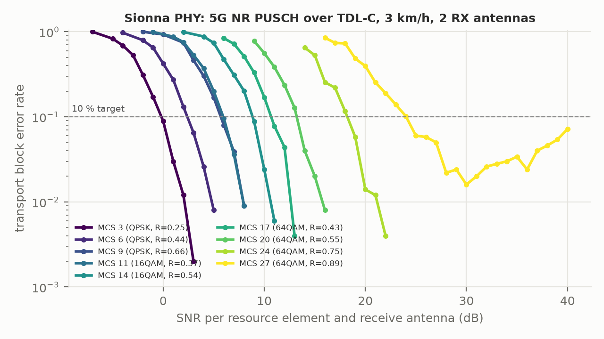
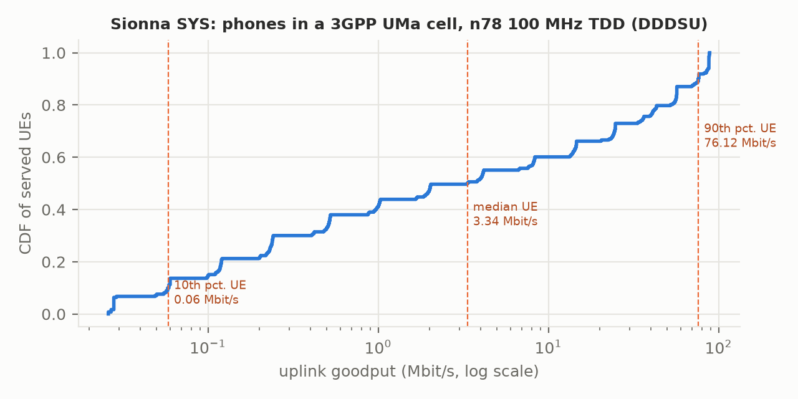
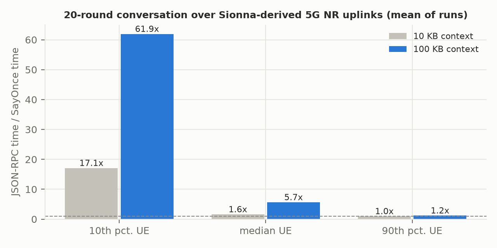

# SayOnce over a Sionna-simulated 5G NR uplink

The network profiles of Section 7 (4G, 3G, EDGE) are hand-picked numbers: a
delay, a loss rate and a bit rate. This experiment replaces them with links
derived from a physical-layer simulation of a 5G NR cell, done with
[NVIDIA Sionna](https://developer.nvidia.com/sionna) (open source, version 2.2,
PyTorch). It answers one question: **for a phone at the cell edge, in the
middle of the cell, and close to the base station, how much faster is a
SayOnce conversation than a JSON-RPC one?**

The uplink is the direction that matters: the agent on the phone sends its
requests (11–12 KB each for JSON-RPC at 10 KB context, 100+ KB at 100 KB), the
replies are a few hundred bytes.

```
Sionna PHY             Sionna SYS                  mapping              SayOnce harness
PUSCH over TDL-C  -->  UMa cell, 2000 phones  -->  rate, delay,   -->  JSON-RPC vs SayOnce
TBLER vs SNR           path loss, UL power         residual loss       over the derived links
per MCS                control, link adaptation    per percentile      (same emulator as §7)
```

## 1. Link level (`sionna_nr/link_level.py`, Sionna PHY)

Complete 5G NR PUSCH slots are simulated end to end with Sionna's NR blocks:
transport-block CRC and segmentation, 5G LDPC coding with rate matching, QAM
mapping, DMRS pilots, OFDM resource grid, a 3GPP TDL channel, LS channel
estimation, LMMSE equalisation and LDPC decoding (20 belief-propagation
iterations). A transport block counts as an error when its CRC fails.

| parameter | value |
|---|---|
| band, numerology | n78, 3.5 GHz, 30 kHz subcarrier spacing |
| MCS | TS 38.214 table 1 (up to 64-QAM): 3, 6, 9, 11, 14, 17, 20, 24, 27 |
| allocation simulated | 16 PRBs, 1 layer, 1 UE antenna, CP-OFDM |
| channel | TDL-C (NLOS), 300 ns delay spread, 3 km/h |
| gNB receive antennas | 2 |
| statistics | MCS 3–14: up to 1000 transport blocks per SNR point (stop at 100 errors); MCS 17–27: up to 500 (stop at 50 errors), to keep the CPU run short |

MCS 0–2 are left out: their code rate is below 1/5, the lowest rate Sionna's
5G LDPC encoder supports. A UE that cannot reach MCS 3 is counted as being in
outage. The SNR of each point is the average SNR per resource element and
receive antenna. The TBLER of an MCS depends on its modulation and code rate
and only weakly on the number of PRBs, so 16 PRBs are simulated to keep the run
short on a CPU, and the transport block size for larger allocations is computed
with Sionna's TS 38.214 TBS procedure.

## 2. System level (`sionna_nr/system_level.py`, Sionna SYS)

| step | Sionna component | setting |
|---|---|---|
| drop phones | `gen_single_sector_topology` | 3GPP TR 38.901 UMa, ISD 500 m, 80 % indoor, 40 drops × 50 UEs |
| channel and path loss | `tr38901.UMa` + `sys.get_pathloss` | O2I low-loss model, shadow fading, 38.901 antenna pattern, 4×2 dual-polarised gNB panel (16 elements) |
| UE transmit power | `sys.open_loop_uplink_power_control` | TS 38.213 open loop, P0 = −90 dBm/PRB, α = 1, P_max = 23 dBm (power class 3) |
| SNR | | thermal noise −174 dBm/Hz, gNB noise figure 5 dB; +9 dB array gain (16 elements vs the 2 simulated at link level, no extra diversity) |
| link adaptation | TBLER curves of step 1 | highest-goodput MCS with first-transmission TBLER ≤ 10 % |
| scheduling | | the UE gets the allocation (1, 2, 4, 8, 17, 34, 68, 136 or 273 PRBs) with the highest goodput: a power-limited phone does better on fewer PRBs |
| goodput | | TBS × (1 − TBLER) / 0.5 ms × 0.2 (TDD pattern DDDSU, one uplink slot in five) |

The cell has no interference from neighbouring cells, which makes the cell
edge optimistic; everything else (indoor penetration, 23 dBm limit, 20 % uplink
share) makes the numbers typical of a loaded n78 macro cell rather than a lab
peak.

## 3. From a UE to an emulator profile (`sionna_nr/mapping.py`)

The 10th, 50th and 90th percentile UEs (by uplink goodput, among served UEs)
become three link profiles for the existing in-process emulator
(`sayonce.bench.netem`):

* **rate** = the UE's uplink goodput (the emulator uses the same rate in both
  directions; replies are tiny, so this barely matters);
* **one-way delay** = 20 ms (core network and transport to the gateway, an
  assumption) + half a TDD period waiting for the next uplink slot (1.25 ms) +
  the expected HARQ retransmissions × 2.5 ms;
* **loss** = TBLER⁴: HARQ retransmits a failed transport block up to 4 times
  before the loss reaches TCP. With a 10 % target this is 10⁻⁴ or less, so on a
  5G link TCP sees almost no loss: the air interface turns errors into delay.

## 4. Running it

Sionna needs Python 3.11+ and PyTorch (a few GB of downloads); a GPU is not
needed. On a 2-core CPU the link level took about an hour, the system level a few
seconds, and the SayOnce runs about 20 minutes (split into parallel parts, see
[results/sionna_nr/README.md](../results/sionna_nr/README.md) for the exact commands).

```bash
pip install -e ".[dev,sionna]"
python sionna_nr/link_level.py   --out results/sionna_nr/bler.csv          # Sionna PHY
python sionna_nr/system_level.py --bler results/sionna_nr/bler.csv \
                                 --out results/sionna_nr                  # Sionna SYS
python sionna_nr/run_sayonce.py  --profiles results/sionna_nr/profiles.json \
                                 --out results/sionna_nr/net.csv --repeats 3
python sionna_nr/analyze.py      --dir results/sionna_nr                  # figures + summary.md
```

The pure mapping functions are tested in `tests/test_sionna_mapping.py`
without Sionna, so the CI does not need it.

## 5. Results

All numbers: [results/sionna_nr/summary.md](../results/sionna_nr/summary.md).

### Link level



The SNR needed for 10 % TBLER rises from −0.2 dB (MCS 3, QPSK, rate 0.25) to
18.2 dB (MCS 24, 64-QAM, rate 0.75) and 24 dB (MCS 27). MCS 27 (code rate 0.89)
never gets below about 2 % TBLER and rises slightly again at very high SNR: with
one DMRS symbol and LS channel estimation, its channel-estimation error does not
shrink fast enough. Link adaptation therefore picks MCS 24 for the best UEs.

### System level



Of 2000 phones (79 % indoor), 239 (11.9 %) cannot reach MCS 3 even on one PRB.
A real network would use MCS 0–2 or fall back to an LTE or low-band uplink for
them. Among the served phones the uplink goodput spans three orders of magnitude:

| percentile of served UEs | 5 | 10 | 25 | 50 | 75 | 90 | 95 |
|---|---|---|---|---|---|---|---|
| uplink (Mbit/s) | 0.03 | 0.06 | 0.23 | 3.34 | 36.3 | 76.1 | 87.8 |

The three profiles given to the emulator:

| profile | UE | path loss | PRBs | SNR | MCS | TBLER | rate | one-way delay | loss |
|---|---|---|---|---|---|---|---|---|---|
| 10th percentile | indoor, 215 m | 141.7 dB | 2 | 0.8 dB | 3 | 3.8 % | 0.058 Mbit/s | 21.4 ms | 2·10⁻⁶ |
| median | indoor, 133 m | 124.7 dB | 68 | 2.5 dB | 6 | 9.4 % | 3.34 Mbit/s | 21.5 ms | 8·10⁻⁵ |
| 90th percentile | indoor, 253 m | 100.2 dB | 273 | 20.9 dB | 24 | 1.2 % | 76.1 Mbit/s | 21.3 ms | 2·10⁻⁸ |

The 10th-percentile phone is power-limited: at 23 dBm it can only keep a usable
SNR on 2 PRBs. HARQ turns its 3.8 % first-transmission errors into a little
extra delay and a residual loss of 2·10⁻⁶.

### SayOnce over the derived links



Total time of a 20-round conversation (setup included), mean of 3 runs, `mcp` workload:

| system | 10th pct., 10 KB | median, 10 KB | 90th pct., 10 KB | 10th pct., 100 KB | median, 100 KB | 90th pct., 100 KB |
|---|---|---|---|---|---|---|
| JSON-RPC | 40.4 s | 1.60 s | 0.95 s | 298.7 s | 6.23 s | 1.26 s |
| JSON-RPC+gzip | 13.9 s | 1.15 s | 0.93 s | 58.5 s | 2.07 s | 1.09 s |
| CBOR, no delta | 33.3 s | 1.49 s | 0.94 s | 247.3 s | 5.42 s | 1.27 s |
| JSON + delta | 5.5 s | 1.03 s | 0.96 s | 18.5 s | 1.32 s | 1.04 s |
| SayOnce | 2.4 s | 0.99 s | 0.97 s | 4.8 s | 1.10 s | 1.04 s |
| **JSON-RPC / SayOnce** | **17.1×** | **1.6×** | **1.0×** | **61.9×** | **5.7×** | **1.2×** |

* **Cell edge.** For the 10th-percentile phone a 100 KB conversation takes
  about 5 minutes with JSON-RPC and 4.8 seconds with SayOnce (62×). Even
  gzip-compressed JSON-RPC needs about a minute (12× SayOnce).
* **Median phone.** 5.7× at 100 KB, 1.6× at 10 KB: the same order as the
  emulated 3G profile of Section 7 (3.8× at 100 KB).
* **Good phone.** At 76 Mbit/s the uplink is not the bottleneck; round trips
  dominate and all systems take about one second (1.0–1.2×), as on the ideal
  link of Section 7.
* **Loss hardly matters on 5G.** HARQ hides almost all radio errors from TCP
  (residual loss ≤ 10⁻⁴), so the gain comes from the uplink rate, not from loss.

Radio energy per 20-round session at 100 KB (LTE RRC parameters of Huang et al.
2012 applied to the NR link, since no measured NR parameters are in the model):
SayOnce saves 95 % for the 10th-percentile phone with back-to-back rounds and
still 60 % with 15 s pauses; for the median phone 50 % back to back and 5 % with
15 s pauses; for the good phone 36 % and 3 %.

### Limitations of this experiment

* Single sector, no inter-cell interference: the cell edge is optimistic in
  SINR, but pessimistic in that MCS 0–2, uplink MIMO and LTE fallback are not
  modelled.
* The link-level curves use 2 receive antennas, the cell's panel has 16; the
  extra array gain is added, the extra diversity is not (conservative).
* The emulator uses the uplink rate in both directions and a constant delay;
  scheduling jitter and the variation of a moving phone are not modelled (a
  Sionna RT ray-tracing trace along a walk would add that).
* The energy model's parameters are for LTE, not NR.
