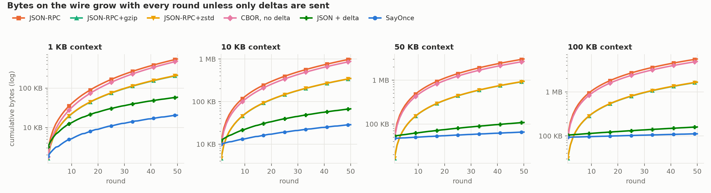
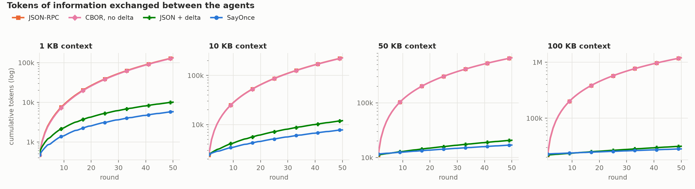

# SayOnce benchmark analysis

Source: `results/preliminary/sweep.csv` (1224 rows), tokenizer `approx`, up to 50 rounds.

> **Preliminary:** token counts are approximate (tiktoken was not available). Re-run the harness with tiktoken before using token numbers in the report.

## 1. Cumulative bytes on the wire

**1 KB context**

| system | round 1 | round 5 | round 10 | round 20 | round 50 |
|---|---|---|---|---|---|
| JSON-RPC | 2.47 KB | 16 KB | 40.5 KB | 116 KB | 548 KB |
| JSON-RPC+gzip | 1.64 KB | 9.57 KB | 22.1 KB | 54.9 KB | 210 KB |
| JSON-RPC+zstd | 1.66 KB | 9.67 KB | 22.3 KB | 55.5 KB | 213 KB |
| CBOR, no delta | 1.81 KB | 12.1 KB | 32.1 KB | 96.3 KB | 483 KB |
| JSON + delta | 3.19 KB | 7.61 KB | 13.2 KB | 24.6 KB | 58.6 KB |
| SayOnce | 1.87 KB | 3.31 KB | 5.17 KB | 9 KB | 20.5 KB |

After 50 rounds SayOnce sends 26.7x fewer bytes than JSON-RPC and 10.2x fewer than JSON-RPC+gzip; it stays below gzip from round 2 on (the uncompressed HELLO costs more at first).

**10 KB context**

| system | round 1 | round 5 | round 10 | round 20 | round 50 |
|---|---|---|---|---|---|
| JSON-RPC | 11.6 KB | 61.5 KB | 132 KB | 298 KB | 1 MB |
| JSON-RPC+gzip | 4.63 KB | 24.3 KB | 51.1 KB | 112 KB | 349 KB |
| JSON-RPC+zstd | 4.68 KB | 24.5 KB | 51.5 KB | 113 KB | 350 KB |
| CBOR, no delta | 9.98 KB | 52.2 KB | 112 KB | 256 KB | 882 KB |
| JSON + delta | 12.3 KB | 16.7 KB | 22.3 KB | 33.7 KB | 67.7 KB |
| SayOnce | 10 KB | 11.5 KB | 13.3 KB | 17.2 KB | 28.7 KB |

After 50 rounds SayOnce sends 35.0x fewer bytes than JSON-RPC and 12.2x fewer than JSON-RPC+gzip; it stays below gzip from round 3 on (the uncompressed HELLO costs more at first).

**50 KB context**

| system | round 1 | round 5 | round 10 | round 20 | round 50 |
|---|---|---|---|---|---|
| JSON-RPC | 52.4 KB | 266 KB | 540 KB | 1.11 MB | 3.04 MB |
| JSON-RPC+gzip | 16.4 KB | 83.3 KB | 169 KB | 348 KB | 938 KB |
| JSON-RPC+zstd | 16.6 KB | 83.8 KB | 170 KB | 349 KB | 943 KB |
| CBOR, no delta | 46.9 KB | 233 KB | 473 KB | 978 KB | 2.69 MB |
| JSON + delta | 53.1 KB | 57.5 KB | 63.2 KB | 74.5 KB | 108 KB |
| SayOnce | 47 KB | 48.4 KB | 50.3 KB | 54.1 KB | 65.6 KB |

After 50 rounds SayOnce sends 46.4x fewer bytes than JSON-RPC and 14.3x fewer than JSON-RPC+gzip; it stays below gzip from round 3 on (the uncompressed HELLO costs more at first).

**100 KB context**

| system | round 1 | round 5 | round 10 | round 20 | round 50 |
|---|---|---|---|---|---|
| JSON-RPC | 104 KB | 521 KB | 1.05 MB | 2.14 MB | 5.6 MB |
| JSON-RPC+gzip | 30.8 KB | 155 KB | 313 KB | 635 KB | 1.66 MB |
| JSON-RPC+zstd | 31.1 KB | 157 KB | 316 KB | 641 KB | 1.67 MB |
| CBOR, no delta | 93 KB | 459 KB | 924 KB | 1.88 MB | 4.93 MB |
| JSON + delta | 104 KB | 109 KB | 114 KB | 126 KB | 160 KB |
| SayOnce | 93.1 KB | 94.5 KB | 96.4 KB | 100 KB | 112 KB |

After 50 rounds SayOnce sends 50.1x fewer bytes than JSON-RPC and 14.8x fewer than JSON-RPC+gzip; it stays below gzip from round 4 on (the uncompressed HELLO costs more at first).

HTTP header share of all bytes:

| context | JSON-RPC | JSON + delta |
|---|---|---|
| 1 | 3.5 % | 34.6 % |
| 10 | 1.9 % | 30.0 % |
| 50 | 0.6 % | 18.7 % |
| 100 | 0.3 % | 12.7 % |

## 2. Tokens exchanged between the agents

Tokens measure information, not encoding: compression does not change them (gzip/zstd are left out), and the CBOR full-context line lies on top of JSON-RPC because both carry the same information.

**1 KB context**

| system | round 1 | round 5 | round 10 | round 20 | round 50 |
|---|---|---|---|---|---|
| JSON-RPC | 470 | 3.28k | 8.78k | 26.5k | 133k |
| CBOR, no delta | 467 | 3.14k | 8.46k | 25.9k | 131k |
| JSON + delta | 550 | 1.31k | 2.28k | 4.26k | 10.1k |
| SayOnce | 471 | 890 | 1.43k | 2.55k | 5.8k |

**10 KB context**

| system | round 1 | round 5 | round 10 | round 20 | round 50 |
|---|---|---|---|---|---|
| JSON-RPC | 2.4k | 12.9k | 28.1k | 65.1k | 228k |
| CBOR, no delta | 2.5k | 12.9k | 27.9k | 64.5k | 227k |
| JSON + delta | 2.48k | 3.24k | 4.22k | 6.17k | 12k |
| SayOnce | 2.5k | 2.92k | 3.46k | 4.56k | 7.8k |

**50 KB context**

| system | round 1 | round 5 | round 10 | round 20 | round 50 |
|---|---|---|---|---|---|
| JSON-RPC | 11.1k | 56.4k | 115k | 239k | 663k |
| CBOR, no delta | 11.6k | 56.8k | 115k | 239k | 662k |
| JSON + delta | 11.2k | 11.9k | 12.9k | 14.9k | 20.7k |
| SayOnce | 11.6k | 12k | 12.6k | 13.7k | 16.9k |

**100 KB context**

| system | round 1 | round 5 | round 10 | round 20 | round 50 |
|---|---|---|---|---|---|
| JSON-RPC | 21.9k | 110k | 223k | 455k | 1.2M |
| CBOR, no delta | 22.9k | 111k | 224k | 455k | 1.2M |
| JSON + delta | 22k | 22.7k | 23.7k | 25.7k | 31.5k |
| SayOnce | 22.9k | 23.4k | 23.9k | 25k | 28.3k |

## 3. Ablation: what does each idea contribute? (50 rounds)

| context | JSON/full | CBOR/full | JSON/delta | CBOR/delta (SayOnce) | binary alone | delta alone | binary on top of delta | both |
|---|---|---|---|---|---|---|---|---|
| 1 KB | 548 KB | 483 KB | 58.6 KB | 20.5 KB | 1.13x | 9.4x | 2.86x | 26.7x |
| 10 KB | 1 MB | 882 KB | 67.7 KB | 28.7 KB | 1.14x | 14.8x | 2.36x | 35.0x |
| 50 KB | 3.04 MB | 2.69 MB | 108 KB | 65.6 KB | 1.13x | 28.1x | 1.65x | 46.4x |
| 100 KB | 5.6 MB | 4.93 MB | 160 KB | 112 KB | 1.14x | 35.1x | 1.43x | 50.1x |

Delta is the main gain. Binary encoding alone saves little when the full context is sent (the context text dominates), but on top of delta it matters more, because the remaining messages are small and their JSON keys, framing and HTTP headers become a large share of each message.

## 4. What the worker's LLM reads (100 KB context)

The worker renders the whole shared context as its prompt every round, in every system, so LLM input tokens are identical across protocols. What changes is how much of that prompt is a repeated prefix that a provider prefix cache can serve.

|  | after 50 rounds |
|---|---|
| LLM input tokens | 1.08M |
| of which not a repeated prefix | 30.3k |
| cacheable share | 97.2 % |

## 5. Cost per 1,000 conversations of 50 rounds

Example prices (set with --price-*): input $3.0/M tokens, cached input $0.3/M, output $15.0/M, data $2.0/GB. **These are assumptions, not quotes.**

**1 KB context**

| system | data transfer cost |
|---|---|
| JSON-RPC | $1.10 |
| JSON-RPC+gzip | $0.42 |
| JSON-RPC+zstd | $0.43 |
| CBOR, no delta | $0.97 |
| JSON + delta | $0.12 |
| SayOnce | $0.04 |

| LLM cost (same for every system) | per 1k conversations |
|---|---|
| prompt re-read every round, no cache | $363.53 |
| with prefix caching | $78.81 |

**10 KB context**

| system | data transfer cost |
|---|---|
| JSON-RPC | $2.01 |
| JSON-RPC+gzip | $0.70 |
| JSON-RPC+zstd | $0.70 |
| CBOR, no delta | $1.76 |
| JSON + delta | $0.14 |
| SayOnce | $0.06 |

| LLM cost (same for every system) | per 1k conversations |
|---|---|
| prompt re-read every round, no cache | $624.51 |
| with prefix caching | $110.39 |

**50 KB context**

| system | data transfer cost |
|---|---|
| JSON-RPC | $6.09 |
| JSON-RPC+gzip | $1.88 |
| JSON-RPC+zstd | $1.89 |
| CBOR, no delta | $5.37 |
| JSON + delta | $0.22 |
| SayOnce | $0.13 |

| LLM cost (same for every system) | per 1k conversations |
|---|---|
| prompt re-read every round, no cache | $1,805.88 |
| with prefix caching | $255.37 |

**100 KB context**

| system | data transfer cost |
|---|---|
| JSON-RPC | $11.20 |
| JSON-RPC+gzip | $3.31 |
| JSON-RPC+zstd | $3.34 |
| CBOR, no delta | $9.87 |
| JSON + delta | $0.32 |
| SayOnce | $0.22 |

| LLM cost (same for every system) | per 1k conversations |
|---|---|
| prompt re-read every round, no cache | $3,275.44 |
| with prefix caching | $435.19 |

LLM cost dominates data cost by orders of magnitude. The protocol's direct saving is in transfer (bytes, time on slow links). Its LLM-side contribution is indirect: a stable, versioned context makes prefix caching reliable.

## 6. Time over emulated links (20 rounds, setup included)

**10 KB context**

| system | ideal | 4g | 3g | edge |
|---|---|---|---|---|
| JSON-RPC | 0.02 s | 1.97 s | 5.41 s | 19.81 s |
| JSON-RPC+gzip | 0.03 s | 1.86 s | 4.56 s | 12.23 s |
| CBOR, no delta | 0.02 s | 1.69 s | 5.27 s | 18.16 s |
| JSON + delta | 0.02 s | 1.62 s | 3.72 s | 8.33 s |
| SayOnce | 0.02 s | 1.61 s | 3.63 s | 7.66 s |
| **JSON-RPC / SayOnce** | **0.8x** | **1.2x** | **1.5x** | **2.6x** |

**100 KB context**

| system | ideal | 4g | 3g | edge |
|---|---|---|---|---|
| JSON-RPC | 0.06 s | 3.85 s | 13.74 s | 95.76 s |
| JSON-RPC+gzip | 0.15 s | 2.47 s | 7.13 s | 33.43 s |
| CBOR, no delta | 0.09 s | 3.17 s | 12.23 s | 84.13 s |
| JSON + delta | 0.05 s | 1.75 s | 4.12 s | 12.16 s |
| SayOnce | 0.05 s | 1.75 s | 4.09 s | 11.16 s |
| **JSON-RPC / SayOnce** | **1.3x** | **2.2x** | **3.4x** | **8.6x** |

The slower the link, the larger the gain. Time savings come from delta; binary encoding changes little once messages are small.
