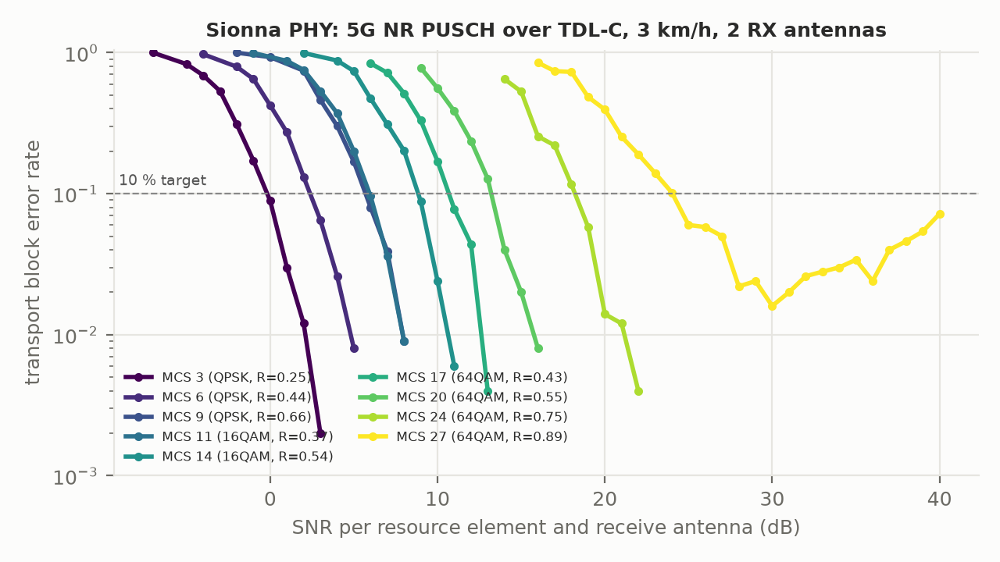
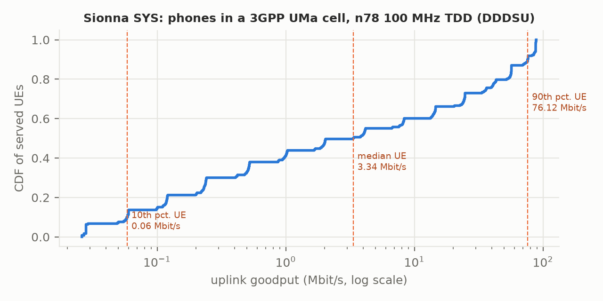
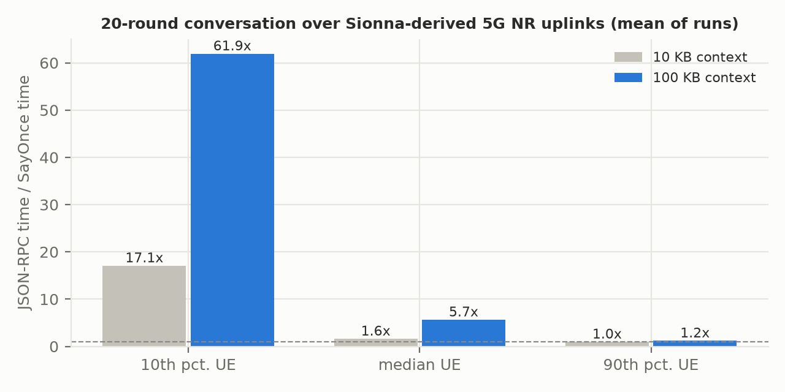

# SayOnce over a Sionna-simulated 5G NR uplink

Sionna 2.2.0; generated by `sionna_nr/analyze.py`. Method and assumptions: `docs/sionna-5g.md`.

## 1. Link level: PUSCH TBLER (Sionna PHY)

SNR at which the first-transmission TBLER reaches 10 % (TDL-C, 300 ns, 3 km/h, 2 RX, LS estimation):

| MCS | modulation | code rate | bits/symbol | SNR @ 10 % TBLER (dB) |
|---|---|---|---|---|
| 3 | QPSK | 0.245 | 0.49 | -0.2 |
| 6 | QPSK | 0.439 | 0.88 | 2.4 |
| 9 | QPSK | 0.663 | 1.33 | 5.7 |
| 11 | 16QAM | 0.369 | 1.48 | 5.9 |
| 14 | 16QAM | 0.540 | 2.16 | 8.8 |
| 17 | 64QAM | 0.428 | 2.57 | 10.7 |
| 20 | 64QAM | 0.554 | 3.32 | 13.2 |
| 24 | 64QAM | 0.754 | 4.52 | 18.2 |
| 27 | 64QAM | 0.889 | 5.33 | 24.0 |

## 2. System level: uplink goodput of phones in a UMa cell (Sionna SYS)

2000 UEs, 79% indoor; 239 UEs (11.9%) cannot reach the lowest simulated MCS and are in outage.

| percentile (served UEs) | 5 | 10 | 25 | 50 | 75 | 90 | 95 |
|---|---|---|---|---|---|---|---|
| uplink Mbit/s | 0.03 | 0.06 | 0.23 | 3.34 | 36.26 | 76.12 | 87.76 |

Link profiles given to the emulator:

| profile | UE | distance | indoor | path loss | PRBs | SNR | MCS | TBLER | rate (Mbit/s) | one-way delay | residual loss |
|---|---|---|---|---|---|---|---|---|---|---|---|
| 10th pct. UE | 1323 | 215 m | yes | 141.7 dB | 2 | 0.8 dB | 3 | 0.038 | 0.0585 | 21.35 ms | 2.05e-06 |
| median UE | 632 | 133 m | yes | 124.7 dB | 68 | 2.5 dB | 6 | 0.094 | 3.3419 | 21.51 ms | 7.88e-05 |
| 90th pct. UE | 1690 | 253 m | yes | 100.2 dB | 273 | 20.9 dB | 24 | 0.012 | 76.1177 | 21.28 ms | 2.14e-08 |

## 3. SayOnce over these links

Total time of a 20-round conversation (setup included), mean over repeats, in seconds:

| system | 10th pct. UE, 10 KB | median UE, 10 KB | 90th pct. UE, 10 KB | 10th pct. UE, 100 KB | median UE, 100 KB | 90th pct. UE, 100 KB |
|---|---|---|---|---|---|---|
| JSON-RPC | 40.36 | 1.60 | 0.95 | 298.68 | 6.23 | 1.26 |
| JSON-RPC+gzip | 13.86 | 1.15 | 0.93 | 58.51 | 2.07 | 1.09 |
| CBOR, no delta | 33.26 | 1.49 | 0.94 | 247.27 | 5.42 | 1.27 |
| JSON + delta | 5.51 | 1.03 | 0.96 | 18.50 | 1.32 | 1.04 |
| SayOnce | 2.36 | 0.99 | 0.97 | 4.82 | 1.10 | 1.04 |
| **JSON-RPC / SayOnce** | **17.1x** | **1.6x** | **1.0x** | **61.9x** | **5.7x** | **1.2x** |

## 4. Radio energy (LTE RRC parameters of Huang et al. 2012 applied to the NR link)

Energy saving of SayOnce against JSON-RPC per 20-round session, 100 KB context:

| profile | gap 0 s | gap 2 s | gap 5 s | gap 15 s |
|---|---|---|---|---|
| 10th pct. UE | 95% | 87% | 76% | 60% |
| median UE | 50% | 21% | 11% | 5% |
| 90th pct. UE | 36% | 13% | 6% | 3% |
